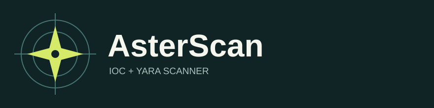

<p align="center"></p>

<p align="center"><strong>Inspect files and, on Windows, processes for known indicators of compromise.</strong></p>

> **Origin and status:** AsterScan is a rebranded fork of [LOKI by Florian Roth](https://github.com/Neo23x0/Loki), based on upstream commit [`7688421`](https://github.com/Neo23x0/Loki/commit/7688421a7094e95453802d97484f2a0b8694a664). It is not an official Nextron Systems release or a new detection engine. Upstream has [deprecated the Python scanner](https://github.com/Neo23x0/Loki#readme). This fork retains the upstream scan logic and GPL license. There is no AsterScan binary release or independent security audit yet.

## What it scans

| Check | Windows | macOS / Linux |
| --- | --- | --- |
| File path and name indicators | Yes | Yes |
| File hashes (MD5, SHA-1, SHA-256) | Yes | Yes |
| YARA rules against files | Yes | Yes |
| Process memory, connections, and Windows-specific checks | Yes, with the required privileges | No |

The scanner reads its rules and indicators from `signature-base/`. Those signatures are **not bundled** in this repository. The updater retrieves them from the upstream [signature-base](https://github.com/Neo23x0/signature-base) and [ReversingLabs YARA rules](https://github.com/reversinglabs/reversinglabs-yara-rules) repositories. Review third-party rules before use in a sensitive environment.

## Quick start

Use a supported Python 3 installation and create a virtual environment. On macOS or Linux:

```sh
git clone https://github.com/nazeeh111/AsterScan.git
cd AsterScan
python3 -m venv .venv
. .venv/bin/activate
python -m pip install -r requirements.txt
python asterscan-updater.py
python asterscan.py -p /path/to/inspect --nolog --noindicator
```

On Windows, activate the virtual environment with `.venv\Scripts\activate`, then run the same `python` commands with a Windows path. Run the terminal as Administrator if you need access to protected files or Windows process checks.

The first scan also attempts to fetch signatures when `signature-base/` is missing. Running the updater explicitly first makes the download and its errors easier to inspect. Network access is needed for signature updates; scanning local files does not require an online service.

## Everyday commands

```sh
python asterscan.py --help
python asterscan.py --version --nolog
python asterscan.py -p /path/to/inspect --noprocscan --nolog
python asterscan.py -p /path/to/inspect --csv --nolog
python asterscan.py --update --nolog
python asterscan-updater.py --sigsonly
```

`--update` and a plain `asterscan-updater.py` run update **signatures only**. Program self-update is opt-in via `asterscan-updater.py --progonly` and requires an AsterScan release; none is published yet. For source checkouts, use Git to update program files. This prevents an ordinary signature refresh from replacing the rebranded files with upstream LOKI binaries.

The scanner reports notices, warnings, and alerts. A clean result means no configured indicator matched in the scope it could inspect; it is not proof that a system is free of malware. Review findings before taking action, and do not upload confidential samples to public analysis services.

## Rules and exclusions

- Put YARA rules in `signature-base/yara/` or `signature-base/iocs/yara/`.
- Put hash and file-name indicators in `signature-base/iocs/`. File names containing `hash`, `filename`, or `c2` determine which loader reads them.
- Edit `config/excludes.cfg` to add regular-expression exclusions for full paths.
- Use `--force` only when you intend to scan a path excluded by the built-in rules.

The source has additional options for scan intensity, file-size limits, syslog, CSV output, and Windows checks. Run `--help` for the current command line reference.

## Build and verify

The Windows PyInstaller specifications are `asterscan.spec` and `asterscan-updater.spec`. They produce `asterscan.exe` and `asterscan-updater.exe` and use the AsterScan icon. The repository runs Python smoke checks on pushes and offers a manually triggered Windows binary build. A passing smoke check does not establish detection accuracy or full operating-system compatibility.

## Credits and license

Original scanner: **Florian Roth and LOKI contributors**. The retained Git history records upstream authorship. AsterScan branding, command names, documentation, and update defaults are fork changes. The project remains under the [GNU GPL v3 or later](LICENSE); third-party notices are retained in `docs/` and relevant source files. Historical upstream images are retained in `screens/` and `docs/upstream-assets/`; they do not depict this fork.

For an actively developed scanner from the original author, see [LOKI RS](https://github.com/Neo23x0/Loki-RS).
